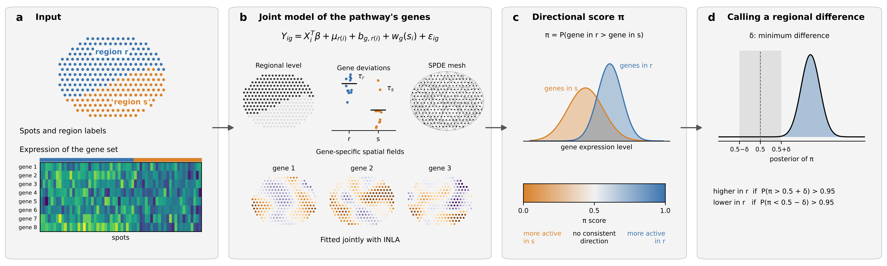

# PISTE

**P**athway **I**nference from **S**patial **T**ranscriptomic **E**xpression

PISTE is an R package for pathway-level analysis of spatial transcriptomics
data. It models all genes of a gene set jointly as a latent Gaussian model
fitted with INLA and answers two questions:

- **Region comparison**: is the pathway more active in one labelled region
  than in another? PISTE reports a directional score π between 0 and 1 and
  its posterior evidence, for every pair of regions and for each region
  against the rest of the tissue. Adjacent sections can be fitted jointly.
- **Spatial map**: where in the tissue is the pathway more or less active?
  PISTE fits a spatial field shared by the genes of the set and returns the
  regions of higher and lower activity, without region labels.

Region comparison can be run on normalized expression (observed mode) or on
raw counts adjusted for cell-type composition (composition-adjusted mode).



## Installation

PISTE requires R 4.1.0 or later.

```r
install.packages("remotes")
remotes::install_github("lingzhuu/PISTE", subdir = "src/piste",
                        dependencies = TRUE)
```

If INLA fails to install, install it first and run the command again:

```r
install.packages("INLA",
                 repos = c(getOption("repos"),
                           INLA = "https://inla.r-inla-download.org/R/stable"),
                 dependencies = TRUE)
```

A Docker image with R, INLA, PISTE and the `piste` command can be built from
the repository:

```bash
git clone https://github.com/lingzhuu/PISTE.git
cd PISTE
docker build -t piste .
```

## Quick start

### R

```r
library(PISTE)

# counts: spots x genes raw counts; region: region label of each spot;
# coords: spots x 2 spot coordinates; gene_sets: named list or GMT file

# Region comparison
res <- compare_regions(counts, region, "pathways.gmt", baseline = "WM",
                       out = "results_compare")
head(res$overall)

# Spatial map
map <- map_activity(counts, coords, "pathways.gmt", out = "results_map")
head(map$gene_sets)
```

### Command line

```bash
piste compare --input sample.h5ad --region-key layer --target WM \
              --gmt pathways.gmt --out results_compare

piste map --input sample.h5ad --coords tissue_positions.csv \
          --gmt pathways.gmt --out results_map
```

## Citation

A manuscript describing PISTE is in preparation.
