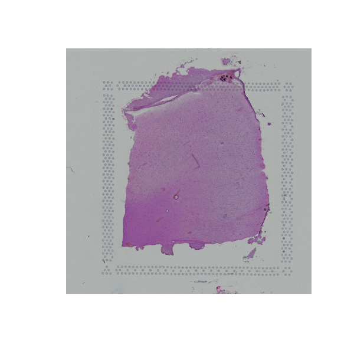
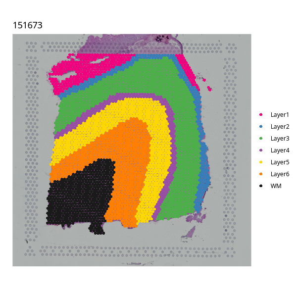

# Composition-adjusted mode on DLPFC

<!-- Generated from doc/examples/composition.Rmd by doc/examples/render.R; edit the .Rmd. -->

The composition-adjusted mode reports the regional difference in pathway
activity that cannot be explained by differences in cell-type composition. It
models raw counts and uses, for each spot, the expression predicted from its
deconvolved cell-type proportions and a single-nucleus RNA-seq reference.

This example uses the human dorsolateral prefrontal cortex (DLPFC) Visium
section 151673 from spatialLIBD (Maynard et al., 2021) and the LIBD DLPFC
snRNA-seq reference (Huuki-Myers et al., 2024). Cell-type proportions are estimated with RCTD,
chosen here because it is fast. White matter (WM) is tested against all
other annotated spots.

## Requirements

Besides SpaPath ([Installation](../installation.md)), which already includes
DESeq2 for the dispersion step, this example uses:

| Package | Source | Used for |
|---------|--------|----------|
| spatialLIBD | Bioconductor | Provides the DLPFC Visium data, its layer annotation and the LIBD DLPFC snRNA-seq reference, and plots spots on the H&E image |
| HDF5Array | Bioconductor | Loads the snRNA-seq reference, which is stored on disk in HDF5 format |
| spacexr | GitHub | RCTD deconvolution |


``` r
install.packages(c("BiocManager", "remotes"))
BiocManager::install(c("spatialLIBD", "HDF5Array"))
remotes::install_github("dmcable/spacexr", build_vignettes = FALSE)
```

## 1. Load the Visium data and the snRNA-seq reference


``` r
library(spatialLIBD)
library(SpatialExperiment)

spe <- fetch_data(type = "spe")
spe <- spe[, spe$sample_id == "151673"]
spe <- spe[, !is.na(spe$layer_guess_reordered)]
rownames(spe) <- make.unique(rowData(spe)$gene_name)

sce_zip <- fetch_data(type = "spatialDLPFC_snRNAseq")
unzip(sce_zip, exdir = tempdir())
sce <- HDF5Array::loadHDF5SummarizedExperiment(
  file.path(tempdir(), "sce_DLPFC_annotated")
)
sce <- sce[, !is.na(sce$cellType_broad_hc)]
rownames(sce) <- make.unique(rowData(sce)$gene_name)
table(sce$cellType_broad_hc)
```

```
#> 
#>     Astro EndoMural     Micro     Oligo       OPC     Excit     Inhib Ambiguous 
#>      3979      2157      1601     10894      1940     24809     11067     21157
```

The H&E image of the section and its manual layer annotation, Layer1 to
Layer6 and white matter:


``` r
plot(imgRaster(spe, sample_id = "151673", image_id = "lowres"))
```




``` r
vis_clus(spe, sampleid = "151673", clustervar = "layer_guess_reordered",
         colors = libd_layer_colors)
```



## 2. Deconvolve with RCTD

RCTD is provided by the spacexr package. Build the reference and the spatial
object from raw counts, then run RCTD in full mode, which allows any number of
cell types per spot:


``` r
library(spacexr)
library(Matrix)

ref_counts <- as(counts(sce), "dgCMatrix")
cell_types <- factor(sce$cellType_broad_hc)
names(cell_types) <- colnames(sce)
reference <- Reference(ref_counts, cell_types, nUMI = colSums(ref_counts))

vis_counts <- as(counts(spe), "dgCMatrix")
coords <- as.data.frame(spatialCoords(spe))
colnames(coords) <- c("x", "y")
rownames(coords) <- colnames(spe)
puck <- SpatialRNA(coords, vis_counts, nUMI = colSums(vis_counts))

rctd <- create.RCTD(puck, reference, max_cores = 8)
rctd <- run.RCTD(rctd, doublet_mode = "full")

omega <- as.matrix(normalize_weights(rctd@results$weights))   # spots x cell types
```

Each row of `omega` holds the cell-type proportions of one spot and sums to
one. The mean proportions in WM and in the other spots:


``` r
in_wm <- spe$layer_guess_reordered[match(rownames(omega), colnames(spe))] == "WM"
round(rbind(WM = colMeans(omega[in_wm, ]), rest = colMeans(omega[!in_wm, ])), 3)
```

```
#>      Astro EndoMural Micro Oligo   OPC Excit Inhib Ambiguous
#> WM   0.014     0.040 0.012 0.486 0.005 0.002 0.001     0.438
#> rest 0.013     0.013 0.003 0.015 0.002 0.108 0.011     0.835
```

Alternatively, cell2location can be used in place of RCTD; it is more
accurate but considerably slower, and a GPU is recommended (REF).

## 3. Reference expression

`reference_profile()` pools the raw counts of all nuclei of each cell type and
scales them to counts per 10,000:


``` r
library(PathwayLGM)

nu <- reference_profile(t(ref_counts), sce$cellType_broad_hc)   # cell types x genes
dim(nu)
```

```
#> [1]     8 36601
```

## 4. Gene sets

20 MSigDB gene sets are stored as a GMT file:


``` r
gmt <- "benchmark/analysis/DLPFC/data/DLPFC_brain_and_reference.gmt"
```

## 5. Run SpaPath

RCTD drops spots with too few counts, so keep the spots that have
proportions. White matter is compared with all other spots:


``` r
spe    <- spe[, rownames(omega)]
counts <- t(counts(spe))                       # spots x genes, raw counts
xy     <- spatialCoords(spe)
region <- ifelse(spe$layer_guess_reordered == "WM", "WM", "rest")

res <- run_spapath(counts, xy, region, gmt, mode = "adjusted",
                   proportions = omega, reference = nu,
                   baseline = "rest", out = "results_adjusted",
                   cfg = list(threads = "8:1"))
```

`run_spapath()` builds the composition offset from `omega` and `nu`, builds
the mesh and fits every gene set to the raw counts. Results are written to
`results_adjusted`. `cfg$threads` sets the number of threads INLA uses, as
`"A:B"`: A threads evaluate hyperparameter configurations in parallel and each
evaluation uses B threads. See [API](../api.md#run_spapath) for all options.

## 6. Read the results


``` r
wm <- res$overall[res$overall$region == "WM", ]
wm <- wm[order(wm$evidence, decreasing = TRUE), ]
rownames(wm) <- NULL
wm[, c("gene_set", "genes", "score", "evidence")]
```

```
#>                                                         gene_set genes
#> 1                                         REACTOME_MRNA_SPLICING   209
#> 2                            REACTOME_NUCLEOTIDE_EXCISION_REPAIR   107
#> 3                                             GOCC_MYELIN_SHEATH    41
#> 4                               REACTOME_SPHINGOLIPID_METABOLISM    95
#> 5                                        GOBP_MYELIN_MAINTENANCE    16
#> 6                             GOBP_MONOCARBOXYLIC_ACID_TRANSPORT   118
#> 7              GOBP_VERY_LONG_CHAIN_FATTY_ACID_METABOLIC_PROCESS    31
#> 8                              REACTOME_CHOLESTEROL_BIOSYNTHESIS    26
#> 9                        REACTOME_TRNA_PROCESSING_IN_THE_NUCLEUS    57
#> 10                                      REACTOME_PROTEIN_FOLDING    86
#> 11                                         REACTOME_MRNA_CAPPING    29
#> 12              GOBP_AXON_ENSHEATHMENT_IN_CENTRAL_NERVOUS_SYSTEM    23
#> 13                          GOBP_SYNAPTIC_TRANSMISSION_GABAERGIC    57
#> 14                                GOBP_OXIDATIVE_PHOSPHORYLATION   134
#> 15                        REACTOME_TRAFFICKING_OF_AMPA_RECEPTORS    31
#> 16                 GOMF_VOLTAGE_GATED_POTASSIUM_CHANNEL_ACTIVITY    82
#> 17                      GOBP_SYNAPTIC_TRANSMISSION_GLUTAMATERGIC    97
#> 18             REACTOME_GLUTAMATE_NEUROTRANSMITTER_RELEASE_CYCLE    24
#> 19                              GOBP_SYNAPTIC_VESICLE_EXOCYTOSIS    98
#> 20 REACTOME_ACTIVATION_OF_NMDA_RECEPTORS_AND_POSTSYNAPTIC_EVENTS    83
#>        score     evidence
#> 1  0.7340654 1.000000e+00
#> 2  0.5763063 9.533256e-01
#> 3  0.6364008 9.528001e-01
#> 4  0.5598524 8.870669e-01
#> 5  0.6117889 8.281931e-01
#> 6  0.5388836 7.864871e-01
#> 7  0.5526556 7.462520e-01
#> 8  0.5542865 7.265082e-01
#> 9  0.5184715 6.097606e-01
#> 10 0.5131305 6.033982e-01
#> 11 0.5191519 5.888173e-01
#> 12 0.4878392 4.506370e-01
#> 13 0.3440909 8.890195e-03
#> 14 0.3991821 6.934165e-03
#> 15 0.2702423 2.103818e-03
#> 16 0.2935550 1.405848e-04
#> 17 0.3145535 7.738131e-05
#> 18 0.1612946 2.904628e-05
#> 19 0.2894858 3.304105e-06
#> 20 0.2341761 1.327769e-07
```

For the WM row, `score` is the posterior mean of π, how often a pathway
gene's expression state in WM exceeds its state in the other spots after
adjusting for cell-type composition, and `evidence` is the posterior
probability that π > 0.5. Evidence near 1 indicates higher activity in WM and
evidence near 0 higher activity in the other spots. For each gene set,
`gene_coefficients` lists each gene's intercept `a_g` and composition slope
`lambda_g`; `lambda_g` near 1 means the gene follows the reference
prediction. For the first gene set:


``` r
head(res$results[[1]]$gene_coefficients)
```

```
#>      gene parameter       mean      lower     median      upper
#> 1  ATP2A2       a_g  0.6269831  0.1756973  0.6269326  1.0785510
#> 2 BLOC1S6       a_g -1.4049910 -1.7345047 -1.4053638 -1.0733832
#> 3    BRAF       a_g -2.6898066 -3.2046080 -2.6898739 -2.1746237
#> 4   BRSK1       a_g -0.7058777 -1.0187736 -0.7049328 -0.3982195
#> 5 CACNA1B       a_g -2.6102274 -3.0774041 -2.6101919 -2.1432525
#> 6  CACNB4       a_g -3.2453446 -3.8240017 -3.2452924 -2.6669838
```

See [API](../api.md#run_spapath) for all outputs.
