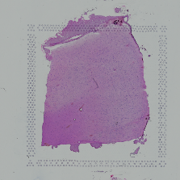
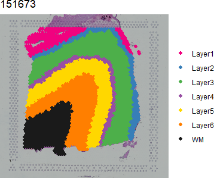

# Observed mode on DLPFC

<!-- Generated from doc/examples/observed.Rmd by doc/examples/render.R; edit the .Rmd. -->

This example tests pathways in white matter (WM) against the cortical layers
of the human dorsolateral prefrontal cortex (DLPFC) Visium section 151673
from spatialLIBD (Maynard et al., 2021). The observed mode fits a Gaussian
model to normalized expression and reports the total regional difference in
pathway activity, including differences that come from cell composition.

## Requirements

This example also uses:

| Package | Source | Used for |
|---------|--------|----------|
| spatialLIBD | Bioconductor | Provides the DLPFC Visium data and its layer annotation, and plots spots on the H&E image |


``` r
install.packages("BiocManager")
BiocManager::install("spatialLIBD")
```


## 1. Load the data


``` r
library(spatialLIBD)
library(SpatialExperiment)
library(PathwayLGM)

spe <- fetch_data(type = "spe")
```

``` r
spe <- spe[, spe$sample_id == "151673"]

# Keep spots with a layer annotation (Layer1 to Layer6, WM).
spe <- spe[, !is.na(spe$layer_guess_reordered)]

counts <- t(counts(spe))                       # spots x genes, raw counts
colnames(counts) <- make.unique(rowData(spe)$gene_name)
xy     <- spatialCoords(spe)
region <- as.character(spe$layer_guess_reordered)
table(region)
```

```
#> region
#> Layer1 Layer2 Layer3 Layer4 Layer5 Layer6     WM 
#>    273    253    989    218    673    692    513
```

`counts`, `xy` and `region` follow the same spot order. The coordinates can
be in any unit.

The H&E image of the section and its manual layer annotation, Layer1 to
Layer6 and white matter:


``` r
plot(imgRaster(spe, sample_id = "151673", image_id = "lowres"))
```




``` r
vis_clus(spe, sampleid = "151673", clustervar = "layer_guess_reordered",
         colors = libd_layer_colors)
```



## 2. Gene sets

20 MSigDB gene sets are stored as a GMT file:


``` r
gmt <- "geneset/DLPFC_brain_and_reference.gmt"
```

## 3. Run SpaPath


``` r
res <- run_spapath(counts, xy, region, gmt, baseline = "WM",
                   out = "results_observed")
```

```
#> 
#>  *** inla.core.safe:  The inla program failed, but will rerun in case better initial values may help. try=1/1 
#> 
#>  *** inla.core.safe:  rerun with improved initial values
```

```
#> 
#>  *** inla.core.safe:  The inla program failed, but will rerun in case better initial values may help. try=1/1 
#> 
#>  *** inla.core.safe:  rerun with improved initial values
```

```
#> 
#>  *** inla.core.safe:  The inla program failed, but will rerun in case better initial values may help. try=1/1 
#> 
#>  *** inla.core.safe:  rerun with improved initial values
```

```
#> 
#>  *** inla.core.safe:  The inla program failed, but will rerun in case better initial values may help. try=1/1 
#> 
#>  *** inla.core.safe:  rerun with improved initial values
```

```
#> 
#>  *** inla.core.safe:  The inla program failed, but will rerun in case better initial values may help. try=1/1 
#> 
#>  *** inla.core.safe:  rerun with improved initial values
```

```
#> 
#>  *** inla.core.safe:  The inla program failed, but will rerun in case better initial values may help. try=1/1 
#> 
#>  *** inla.core.safe:  rerun with improved initial values
```

```
#> 
#>  *** inla.core.safe:  The inla program failed, but will rerun in case better initial values may help. try=1/1 
#> 
#>  *** inla.core.safe:  rerun with improved initial values
```

`run_spapath()` normalizes the counts with SCTransform, builds the mesh and
fits every gene set, with WM as the baseline region. Results are written to
`results_observed`. See [API](../api.md#run_spapath) for all options.

## 4. Read the results


``` r
wm <- res$overall[res$overall$region == "WM", ]
wm <- wm[order(wm$evidence, decreasing = TRUE), ]
rownames(wm) <- NULL
wm[, c("gene_set", "genes", "score", "evidence")]
```

```
#>                                                         gene_set genes
#> 1                                             GOCC_MYELIN_SHEATH    42
#> 2                               REACTOME_SPHINGOLIPID_METABOLISM    96
#> 3               GOBP_AXON_ENSHEATHMENT_IN_CENTRAL_NERVOUS_SYSTEM    23
#> 4              GOBP_VERY_LONG_CHAIN_FATTY_ACID_METABOLIC_PROCESS    32
#> 5                                        GOBP_MYELIN_MAINTENANCE    16
#> 6                            REACTOME_NUCLEOTIDE_EXCISION_REPAIR   107
#> 7                              REACTOME_CHOLESTEROL_BIOSYNTHESIS    26
#> 8                                          REACTOME_MRNA_CAPPING    29
#> 9                        REACTOME_TRNA_PROCESSING_IN_THE_NUCLEUS    57
#> 10                                      REACTOME_PROTEIN_FOLDING    88
#> 11                          GOBP_SYNAPTIC_TRANSMISSION_GABAERGIC    59
#> 12 REACTOME_ACTIVATION_OF_NMDA_RECEPTORS_AND_POSTSYNAPTIC_EVENTS    84
#> 13                      GOBP_SYNAPTIC_TRANSMISSION_GLUTAMATERGIC   100
#> 14             REACTOME_GLUTAMATE_NEUROTRANSMITTER_RELEASE_CYCLE    24
#> 15                        REACTOME_TRAFFICKING_OF_AMPA_RECEPTORS    31
#>        score     evidence
#> 1  0.6922329 9.988453e-01
#> 2  0.6187125 9.983953e-01
#> 3  0.7274945 9.977120e-01
#> 4  0.6301380 9.703229e-01
#> 5  0.6504722 9.587596e-01
#> 6  0.5569454 9.452628e-01
#> 7  0.6139136 9.325164e-01
#> 8  0.5813712 8.562173e-01
#> 9  0.5582827 8.498671e-01
#> 10 0.5034565 5.367441e-01
#> 11 0.3484737 8.314528e-04
#> 12 0.3286696 1.255088e-05
#> 13 0.2655723 0.000000e+00
#> 14 0.1835766 0.000000e+00
#> 15 0.1858631 0.000000e+00
```

The `overall` table compares each region with the spot-weighted average of all
other regions. For the WM row, `score` is the posterior mean of π, how often a
pathway gene's expression state in WM exceeds its state in the cortical
layers, and `evidence` is the posterior probability that π > 0.5. Evidence
near 1 indicates higher activity in WM and evidence near 0 higher activity in
the cortical layers. `res$pairwise` gives the same quantities for every pair
of regions. See [API](../api.md#run_spapath) for all outputs.
